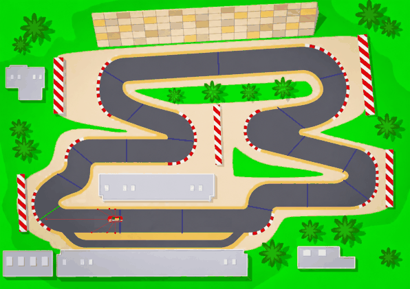
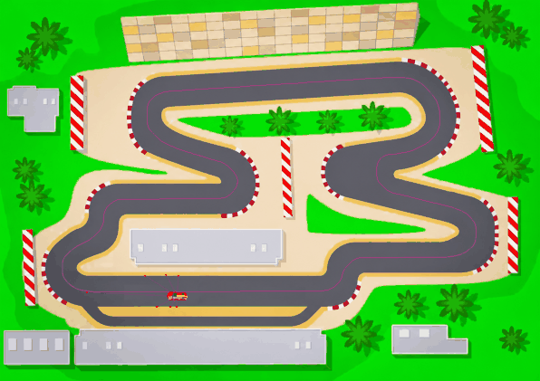

# 🏎️ RL Car Agent - Autonomous Racing using Reinforcement Learning

## Overview

RL Car Agent is a custom Reinforcement Learning project where an autonomous car learns to drive a 2D top-down racing circuit. The environments are built with Gymnasium and Pygame and include vehicle physics, LiDAR-style sensors and road-mask collision detection. The agents learn purely from interaction, with no human driving data.

The project contains two approaches, each in its own folder:

| Folder | Algorithm | Actions | Reward | Physics |
| ------ | --------- | ------- | ------ | ------- |
| [`ppo_checkpoints/`](ppo_checkpoints/README.md) | PPO | 9 discrete (steer × throttle) | Progress toward 17 checkpoint gates | Simple arcade, max speed 6 |
| [`sac_centerline/`](sac_centerline/README.md) | SAC | Continuous steer + throttle | Progress along the track centerline, offset-penalty curriculum | Grip-limited, max speed 9 |

---

## Results

| PPO (9 actions), flying lap | SAC, flying lap |
| :---: | :---: |
|  |  |

The yellow trail is the line the car drove on that lap. PPO's line stays close to the middle of the road. SAC's uses more of the width, swinging out before corners and cutting toward the inside in the hairpins, because its physics punish turning tightly at speed.

All numbers are from one deterministic 3000-step episode (50 simulated seconds) from the start line, unless noted.

| Agent | Training | Best flying lap | Avg speed (px/step) | Laps | Crashes |
| ----- | -------- | --------------- | ------------------- | ---- | ------- |
| PPO, 5 single actions (earlier version) | 1M steps, CPU | 10.52 s | 5.51 | 4 | none |
| PPO, 9 combined actions | 1.5M steps, CPU | 10.17 s | 5.88 | 4 | none |
| Scripted centerline follower (SAC physics, reference) | none | 11.78 s | 5.20 | 4 | none |
| **SAC, grip-limited** | 500k steps, GPU | **9.63 s** | **6.21** | **5** | **0 / 50 random starts** |

* **Combined actions helped PPO.** Turning while accelerating or braking cut 0.35 s off the lap. Its average speed is 98% of the car's top speed of 6.
* **SAC is fastest despite stricter physics.** It has to brake hard for the hairpins, but it can reach 9 px/step on the straights. Its average of 6.21 is above PPO's top speed. It is also 2.15 s quicker than a scripted controller that follows the centerline at the grip limit, which shows the gain from choosing its own line.
* **Curriculum.** SAC's evaluation lap went from 12.50 s at 100k steps, while the offset penalty still held it near the centerline, to 10.40 s at 250k when the penalty reached 0, and 9.60 s by 440k.
* **Robustness.** From 50 random start points, the final SAC model completed 5 laps every time with no crashes. The highest-scoring evaluation checkpoint (`best_model.zip`, 9.60 s from the start line) crashed in 4 of 50 random starts, all just after spawning. So `sac_centerline/evaluate.py` uses the final model by default.

PPO and SAC drive different car physics here, so the table compares complete solutions, not the algorithms alone.

---

## Features

* Two custom Gymnasium racing environments sharing one track, road mask and sensor model
* PPO (discrete) and SAC (continuous) agents with Stable-Baselines3
* 7 LiDAR-style distance sensors, vectorised with NumPy
* Road-mask collision detection with a 5-point hitbox
* Checkpoint-gate reward (PPO) and centerline-progress reward (SAC)
* Centerline extracted automatically from the track image (distance map + Dijkstra)
* Grip-limited physics so braking and racing lines matter (SAC)
* Curriculum learning: a lateral-offset penalty that anneals to 0 (SAC)
* Randomised start positions along the track (SAC)
* Lap timing, best flying lap, average speed and crash-rate metrics
* GIF recording of a flying lap with the driven racing line drawn on the track
* Parallel environments, best-model and checkpoint saving, optional TensorBoard

---

## Project Structure

```text
deep-rl-track-navigation/
│
├── assets/
│   ├── circuit.png               # Racing track image
│   ├── car.png                   # Car sprite
│   ├── ppo_lap.gif               # Recorded flying lap, PPO
│   └── sac_lap.gif               # Recorded flying lap, SAC
│
├── ppo_checkpoints/
│   ├── race_circuit.py           # Track, road mask, car physics, sensors, manual drive (shared)
│   ├── car_env.py                # Gymnasium env: discrete actions, checkpoint gates
│   ├── train.py                  # PPO training
│   ├── evaluate.py               # Watch / measure / record a PPO agent
│   ├── evaluation.py             # Lap metrics and GIF recording (shared)
│   └── README.md
│
├── sac_centerline/
│   ├── centerline.py             # Builds centerline.csv from the road mask
│   ├── centerline.csv            # Generated centerline (x, y, half-width)
│   ├── centerline_preview.png
│   ├── track.py                  # Centerline projection, arc length, curvature
│   ├── sac_env.py                # Gymnasium env: continuous actions, grip-limited physics
│   ├── train.py                  # SAC training with the offset curriculum
│   ├── evaluate.py               # Watch / measure / record a SAC agent
│   └── README.md
│
├── .gitignore
├── README.md
└── requirements.txt
```

Each folder writes its trained models to `models/` and logs to `logs/`, both git-ignored.

---

## Shared Track and Sensors

### Road mask and collisions

A boolean **road mask** is built once when the track loads:

* Asphalt is the only dark, low-saturation grey in the track image.
* Only the grey region connected to the start line is kept, which removes building outlines and other false positives.

The car crashes when any of **5 hitbox points** (four corners plus the centre) leaves the road: grass, sand, kerbs, barriers or the screen edge.

### LiDAR sensors

7 rays at -90°, -60°, -30°, 0°, +30°, +60° and +90° from the car's heading, each up to 250 px long and sampled every 3 px. A ray stops at the first point off the road mask. Distances are normalised to 0-1, where 0 means the edge is right next to the car and 1 means no edge within range. All 7 rays are computed at once with NumPy.

### Lap timing

The simulation runs at 60 steps per second, so lap times are given in simulated seconds. Lap 1 includes the standing start, so the headline number is the **best flying lap**.

---

## PPO + Checkpoint Gates

* **Observation (10):** 7 LiDAR distances, speed, and sin/cos of the angle to the next gate.
* **Actions (9):** every combination of steer {left, straight, right} × throttle {accelerate, coast, brake}.
* **Reward:** +0.1 per pixel closed toward the next gate, +10 per gate, +50 per lap, -0.05 per step, -100 for leaving the road. Driving away from the gate, circling or oscillating earns nothing.
* **Episode end:** crash, 3000 steps, or 300 steps without passing a gate.
* **Training:** 8 parallel envs, 1.5M steps, `[128, 128]` MLP, lr 3e-4, n_steps 1024, batch 256, entropy 0.01. Runs on the CPU.

Earlier versions used 5 single actions (left, right, accelerate, brake, coast). Allowing combined actions let the car steer and accelerate together, which made its laps faster (see Results).

Details: [ppo_checkpoints/README.md](ppo_checkpoints/README.md)

---

## SAC + Centerline Progress

* **Centerline:** extracted from the road mask with a distance-to-edge map and Dijkstra between the checkpoint gates. The lap is 3736 px long.
* **Physics:** a grip limit, `speed × turn rate ≤ 0.4`. The faster the car goes, the wider its tightest turn, so it has to brake for hairpins or take a wider line.
* **Observation (19):** 7 LiDAR distances, speed, heading error to the track tangent, lateral offset, curvature at 6 points up to 300 px ahead, and the previous action.
* **Actions:** continuous steer and throttle, each in [-1, 1].
* **Reward:** +0.1 per pixel of progress along the centerline, -0.01 per step, -0.05 × |steering change|, -c1 × (offset / half-width)², -50 for leaving the road.
* **Curriculum:** c1 starts at 0.3 and anneals to 0 over the first half of training. The agent first learns to stay central, then is free to find its own racing line.
* **Random starts:** training episodes begin at random points around the track.
* **Training:** 4 parallel envs, 500k steps, `[256, 256]` networks, batch 512, GPU if available.

Details: [sac_centerline/README.md](sac_centerline/README.md)

---

## Installation

```bash
git clone https://github.com/AshutoshP29/deep-rl-track-navigation.git
cd deep-rl-track-navigation

python -m venv venv
venv\Scripts\activate        # Windows (source venv/bin/activate on macOS/Linux)
pip install -r requirements.txt
```

`requirements.txt` installs the CPU build of PyTorch. To train SAC on an NVIDIA GPU, install the CUDA build afterwards, for example:

```bash
pip install --force-reinstall --no-deps torch==2.12.0 --index-url https://download.pytorch.org/whl/cu130
```

For a network this small, the GPU mainly frees up the CPU. PPO always trains on the CPU.

---

## Usage

### Drive it yourself

```bash
cd ppo_checkpoints
python race_circuit.py       # arrow keys: ↑ accelerate, ↓ brake, ← → steer
```

### PPO

```bash
cd ppo_checkpoints
python train.py                          # 1.5M steps, 8 envs
python evaluate.py                       # watch the best model
python evaluate.py --episodes 1          # lap times and metrics, headless
python evaluate.py --gif ../assets/ppo_lap.gif
```

### SAC

```bash
cd sac_centerline
python train.py                          # 500k steps
python evaluate.py                       # watch the best model
python evaluate.py --episodes 1 --random-starts 50
python evaluate.py --gif ../assets/sac_lap.gif
```

Optional TensorBoard logging, if `tensorboard` is installed:

```bash
tensorboard --logdir logs/tensorboard
```

---

## Future Improvements

* ✅ ~~Faster training using vectorised environments~~
* ✅ ~~Improved reward shaping~~
* ✅ ~~SAC with continuous steering and throttle~~
* ✅ ~~Centerline-progress reward with an annealed lateral-offset penalty (curriculum)~~
* ✅ ~~Grip-limited physics so the agent can learn racing lines~~
* ✅ ~~Combined steer + throttle actions for PPO~~
* ✅ ~~Randomised start positions (SAC)~~
* ✅ ~~Lap timing and performance metrics~~
* Track randomisation and multiple racing circuits
* Camera-based observations using CNN policies
* Grip-limited physics for PPO too, for a like-for-like algorithm comparison

---

## Technologies Used

* Python
* Gymnasium
* Stable-Baselines3 (PPO, SAC)
* PyTorch
* NumPy
* Pygame
* Pillow (GIF recording)

---

## License

This project is intended for educational and research purposes.

Feel free to modify and extend the environment for your own reinforcement learning experiments.
