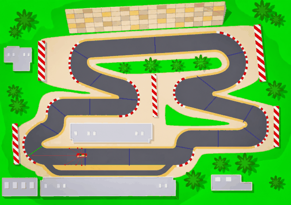

# PPO + Checkpoint Gates

## Files

| File | Purpose |
|---|---|
| `race_circuit.py` | Track loading, road mask, car physics, lidar sensors. Run it to drive manually. Also used by `sac_centerline/`. |
| `car_env.py` | Gymnasium environment `RacingEnv`. Run it to watch random actions. |
| `train.py` | Trains PPO. Options: `--timesteps`, `--n-envs`, `--seed`. |
| `evaluate.py` | Watches a trained model drive, or measures it. Options: `--model`, `--episodes N`, `--gif PATH`. |
| `evaluation.py` | Lap metrics and GIF recording, shared with `sac_centerline/`. |

Training writes to `models/` (`best_model.zip`, `ppo_racing_final.zip`, periodic `checkpoints/`) and `logs/` (eval results, TensorBoard if installed). Both are git-ignored.

## Environment

**Actions (discrete, 9):** every combination of steer {left, straight, right} × throttle {accelerate, coast, brake/reverse}, so the car can turn while accelerating or braking. (An earlier version had 5 single actions: left, right, accelerate, brake, coast.)

**Observation (10 values):**
- 7 lidar distances to the track edge (-90° to +90°), normalised 0-1
- speed / max speed
- sin and cos of the angle between the car's heading and the next gate

**Reward per step:**

| Term | Value |
|---|---|
| Progress toward the next gate | +0.1 per pixel closed (negative when moving away) |
| Passing the next gate in order | +10 |
| Completing a lap | +50 |
| Time penalty | -0.05 |
| Leaving the road | -100, episode ends |

Episodes are cut off after 3000 steps, or after 300 steps without passing a gate.

**Track limits:** a road mask is built once from the asphalt colour in `circuit.png`. The car crashes if any of 5 hitbox points (four corners and centre) leaves it.

## Training and evaluation

```bash
python train.py                          # defaults: 1.5M steps, 8 envs, CPU
tensorboard --logdir logs/tensorboard   # optional

python evaluate.py                       # watch the best model
python evaluate.py --episodes 1          # lap times, avg speed, reward (headless)
python evaluate.py --gif ../assets/ppo_lap.gif
```

Lap times are in simulated seconds (60 steps = 1 s). Lap 1 includes the standing start, so the best lap is the fastest *flying* lap.

## Results



One deterministic 3000-step episode from the start line:

| Actions | Training | Best flying lap | Avg speed | Laps | Crashes |
|---|---|---|---|---|---|
| 5 single actions (earlier version) | 1M steps | 10.52 s | 5.51 | 4 | none |
| 9 combined actions | 1.5M steps (~25 min, 8 envs) | **10.17 s** | **5.88** | 4 | none |

Every evaluation after 325k steps ran the full 3000 steps without crashing. The agent's average speed is 98% of the car's top speed of 6, so there is little left to gain under these physics. `sac_centerline/` adds grip limits to make racing lines matter.
