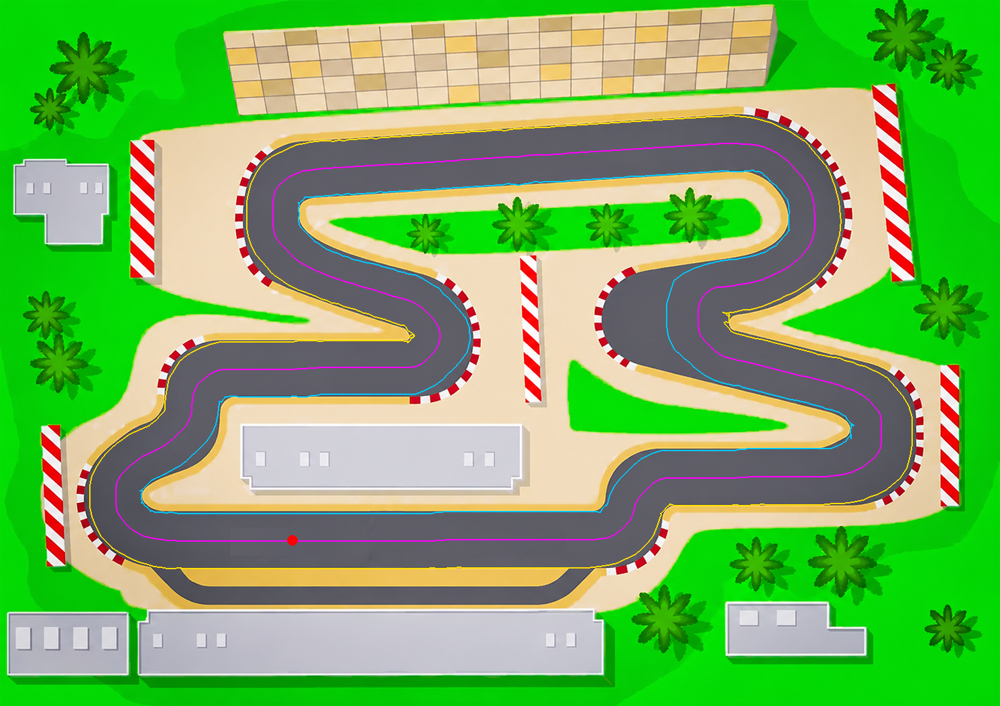
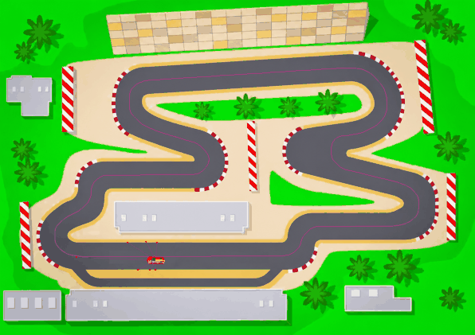

# SAC + Centerline Progress

A continuous-control agent that has to find its own racing line. Compared with `ppo_checkpoints/`:

- **Continuous actions:** steering and throttle are each a value in [-1, 1].
- **Grip-limited physics:** the car's turn rate is capped by `speed × turn rate ≤ MAX_LAT_ACCEL`, so the faster it goes, the wider its tightest turn. It has to brake for corners or take them on a wider line.
- **Centerline-progress reward:** the car is rewarded for distance driven along the track, rather than for reaching hand-placed gates.

## Files

| File | Purpose |
|---|---|
| `centerline.py` | Builds `centerline.csv` from the road mask. Run once; it also writes `centerline_preview.png`. |
| `centerline.csv` | Generated centerline: `x, y, half_width` every 8 px, starting on the start/finish line. |
| `track.py` | Loads the centerline, and projects the car onto it (arc length `s`, lateral offset, curvature). |
| `sac_env.py` | Gymnasium environment `CenterlineRacingEnv` and the `GripCar` physics. Run it to watch random actions. |
| `train.py` | Trains SAC with the offset-penalty curriculum. |
| `evaluate.py` | Watches a trained model, or measures lap times, random-start robustness, and records a GIF. |

The track image, road mask, lidar and car sprite are shared with `ppo_checkpoints/race_circuit.py`, and the metrics/GIF code with `ppo_checkpoints/evaluation.py`. `track.py` adds that folder to `sys.path`.

## Centerline



`centerline.py` builds it from the road mask using only NumPy:

1. A distance-to-edge map of the road mask (repeated erosion).
2. Dijkstra from each of the PPO checkpoint gates to the next on a half-resolution grid. Each step costs `1 + 400 / distance²`, so the cheapest path follows the middle of the road.
3. Smoothing, resampling every 8 px, and reading each point's half-width from the distance map.

The lap is 3736 px long and the road is 35-49 px wide either side of the line. The tightest corner has a radius of about 37 px.

## Environment

**Physics (`GripCar`):**

| Parameter | Value |
|---|---|
| Max speed | 9 px/step (reverse 2) |
| Acceleration / braking | 0.15 / 0.3 per step |
| Drag | ×0.99 per step |
| Max turn rate | 6° per step at low speed |
| Grip limit | `speed × turn rate ≤ 0.4` px/step² |

At 9 px/step the tightest turn the car can make has a radius of about 200 px. The tightest hairpin can only be taken at around 4 px/step.

**Actions:** `[steer, throttle]`, both in [-1, 1]. Steer +1 = full left. Throttle below 0 brakes, and reverses once the car has stopped.

**Observation (19 values, all in [-1, 1]):**

| Index | Value |
|---|---|
| 0-6 | Lidar distances to the track edge (-90° to +90°), 0-1 |
| 7 | Speed / max speed |
| 8-9 | sin, cos of the heading error to the centerline tangent |
| 10 | Lateral offset / half-width (+ = left) |
| 11-16 | Centerline curvature 0, 50, 100, 150, 200, 300 px ahead (+ = left turn), ×30 |
| 17-18 | Previous steer and throttle |

**Reward per step:**

| Term | Value |
|---|---|
| Progress along the centerline | +0.1 per pixel of arc length `Δs` (negative when going backwards) |
| Time penalty | -0.01 |
| Steering change | -0.05 × \|Δsteer\| (discourages twitching) |
| Lateral offset | -c1 × (offset / half-width)² |
| Leaving the road | -50, episode ends |

A lap is one track length of net progress. Episodes are cut off after 3000 steps, or after 200 steps without beating the furthest progress so far.

## Curriculum

`c1`, the lateral-offset weight, starts at 0.3 and anneals linearly to 0 over the first half of training (`OffsetCurriculum` in `train.py`, applied via `VecEnv.env_method`). Early on, staying near the centerline is the easiest way to stay on the road. Once `c1` is 0, only progress counts, so the agent is free to cut apexes and use the full width of the track.

Training episodes start at random points on the centerline, slightly off-centre and off-angle, from a standstill. That way the agent sees every corner early on instead of only the first few. Evaluation always starts from the real start line with `c1 = 0`, so evaluation scores stay comparable as the curriculum moves.

## Training and evaluation

```bash
python centerline.py                      # only needed if circuit.png changes
python train.py                           # 500k steps, 4 envs, GPU if available
python train.py --device cpu --timesteps 300000

python evaluate.py                        # watch the best model from the start line
python evaluate.py --watch-random         # watch from random start points
python evaluate.py --episodes 1 --random-starts 50
python evaluate.py --gif ../assets/sac_lap.gif
```

SAC defaults: learning rate 3e-4, buffer 300k, batch 512, 2 gradient steps per vectorised step (4 envs), γ 0.99, τ 0.005, auto-tuned entropy, `[256, 256]` networks. For a network this small, each update costs about the same at batch 256 or 512, on GPU or CPU (it is limited by per-operation overhead, not maths). So fewer, larger updates train fastest.

## Results



500k steps on an RTX 4050 Laptop GPU took about 2 hours. Evaluation is a deterministic 3000-step episode from the start line:

| Steps | Offset weight c1 | Best flying lap | Avg speed | Laps |
|---|---|---|---|---|
| 100k | 0.18 | 12.50 s | 5.05 | 3 |
| 210k | 0.05 | 10.70 s | 5.82 | 4 |
| 250k | 0 | 10.40 s | 5.89 | 4 |
| 300k | 0 | 9.98 s | 6.13 | 4 |
| 440k (`best_model.zip`) | 0 | 9.60 s | 6.27 | 5 |
| 500k (`sac_racing_final.zip`) | 0 | 9.63 s | 6.21 | 5 |

For reference, a scripted controller that follows the centerline at the grip-limit speed laps in 11.78 s, and PPO (different, simpler physics) in 10.17 s.

**Random starts (50 episodes each):**

| Model | Crash rate | Mean laps | Best lap |
|---|---|---|---|
| `sac_racing_final.zip` | 0% | 5.00 | 9.60 s |
| `best_model.zip` | 8% (all just after spawning) | 4.60 | 9.57 s |

`best_model.zip` is picked on a single start-line episode, so it is slightly over-fitted to that start. `evaluate.py` uses the final model by default.

From 60k steps on, every evaluation episode lasted the full 3000 steps except two, at 320k and 350k, which crashed while the policy was learning where the grip limit is. Training recovered from both.
